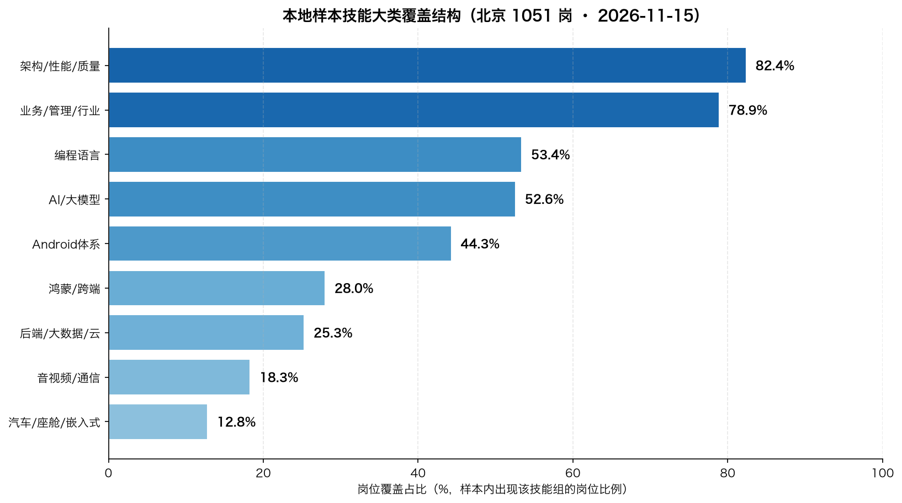
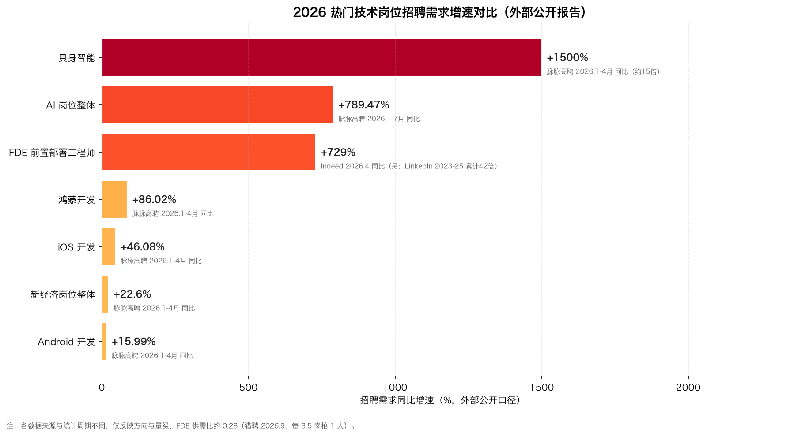

# 岗位技能与需求分析报告（基线期）

- 采集日期：2026-11-15　|　城市口径：北京　|　样本：去重后 **1308** 个岗位
- tab 命中（多对多）：android 446，harmonyos 441，recommend 381，ai_agent 110，fde 148
- 说明：本期为第一期基线，尚无历史期可比，环比/上升衰退列保留待第二期回填；薪资受字体反爬影响未纳入统计。
- 采集状态：三 tab（recommend/harmonyos/android）与两个检索组（ai_agent/fde）合并采集，清洗去噪后 **1308** 个唯一岗位。
- 检索组口径：ai_agent 为 AI/大模型/Agent 研发岗；fde 分「核心 FDE」（标题含 FDE/前沿·前线部署）与「相邻交付/解决方案/部署岗」两层，纯销售、投资出版、芯片/FPGA 原型验证、纯客户成功商务岗已剔除。
- 口径：关键词区分「岗位覆盖数」（命中岗位数）与「词频」（出现次数）；纯英文短词按词边界匹配。

## 一、技能分组岗位覆盖

| 技能分组 | 命中岗位数 | 覆盖率 | 代表关键词（覆盖:词频） |
|---|---|---|---|
| 编程语言 | 699 | 53.4% | java(462:691)、kotlin(346:474)、c++(179:237)、python(144:172)、typescript(88:97) |
| Android体系 | 580 | 44.3% | android(554:2333)、sdk(188:466)、framework(88:148)、jetpack(84:107)、binder(42:45) |
| 音视频/通信 | 239 | 18.3% | 视频(149:353)、音视频(81:160)、tcp(42:51)、蓝牙(40:83)、音频(39:93) |
| 鸿蒙/跨端 | 366 | 28.0% | 跨端(160:287)、flutter(158:371)、鸿蒙(151:618)、react native(107:177)、跨平台(104:159) |
| AI/大模型 | 688 | 52.6% | ai(597:2700)、agent(314:1123)、大模型(259:524)、智能体(107:267)、llm(96:144) |
| 架构/性能/质量 | 1078 | 82.4% | 优化(878:2175)、架构(725:1765)、性能(671:1534)、稳定性(384:607)、性能优化(356:515) |
| 后端/大数据/云 | 331 | 25.3% | 数据库(122:177)、全栈(112:227)、分布式(84:127)、服务端(66:88)、大数据(43:84) |
| 汽车/座舱/嵌入式 | 167 | 12.8% | linux(88:133)、车载(42:122)、座舱(35:101)、智能座舱(27:46)、嵌入式(25:36) |
| 业务/管理/行业 | 1032 | 78.9% | 团队(835:1931)、协作(474:713)、解决方案(196:388)、成本(138:206)、团队管理(109:142) |

### 本地样本技能大类覆盖结构

### 外部岗位招聘需求增速（公开报告口径）

> 外部公开报告口径，来源与统计周期不同，仅反映方向与量级；本地为单期快照，无法计算环比/同比。

| 方向 | 同比增速 | 来源与周期 |
|---|---|---|
| 具身智能 | +1500% | 脉脉高聘 2026.1-4月 同比（约15倍） |
| AI 岗位整体 | +789.47% | 脉脉高聘 2026.1-7月 同比 |
| FDE 前置部署工程师 | +729% | Indeed 2026.4 同比（另：LinkedIn 2023-25 累计42倍） |
| 鸿蒙开发 | +86.02% | 脉脉高聘 2026.1-4月 同比 |
| iOS 开发 | +46.08% | 脉脉高聘 2026.1-4月 同比 |
| 新经济岗位整体 | +22.6% | 脉脉高聘 2026.1-4月 同比 |
| Android 开发 | +15.99% | 脉脉高聘 2026.1-4月 同比 |

> FDE 供需比约 0.28（猎聘 2026.9，每 3.5 岗抢 1 人）；国内 FDE 平均年薪约 40.8 万元。

## 二、全量高频关键词 TOP 20

| 排名 | 关键词 | 覆盖岗位数 | 词频 | 覆盖率 |
|---|---|---|---|---|
| 1 | 优化 | 878 | 2175 | 67.1% |
| 2 | 团队 | 835 | 1931 | 63.8% |
| 3 | 架构 | 725 | 1765 | 55.4% |
| 4 | 性能 | 671 | 1534 | 51.3% |
| 5 | ai | 597 | 2700 | 45.6% |
| 6 | android | 554 | 2333 | 42.4% |
| 7 | 协作 | 474 | 713 | 36.2% |
| 8 | java | 462 | 691 | 35.3% |
| 9 | 稳定性 | 384 | 607 | 29.4% |
| 10 | 性能优化 | 356 | 515 | 27.2% |
| 11 | kotlin | 346 | 474 | 26.5% |
| 12 | agent | 314 | 1123 | 24.0% |
| 13 | 大模型 | 259 | 524 | 19.8% |
| 14 | 解决方案 | 196 | 388 | 15.0% |
| 15 | 监控 | 189 | 254 | 14.4% |
| 16 | sdk | 188 | 466 | 14.4% |
| 17 | c++ | 179 | 237 | 13.7% |
| 18 | 跨端 | 160 | 287 | 12.2% |
| 19 | flutter | 158 | 371 | 12.1% |
| 20 | arkts | 156 | 204 | 11.9% |

## 三、分 tab 高频关键词

### android（n=446）

| 关键词 | 覆盖岗位数 | 词频 |
|---|---|---|
| 优化 | 351 | 946 |
| 性能 | 321 | 769 |
| 架构 | 316 | 722 |
| android | 309 | 1315 |
| 团队 | 291 | 618 |
| ai | 256 | 1320 |
| java | 255 | 386 |
| 协作 | 215 | 336 |
| 稳定性 | 200 | 311 |
| kotlin | 188 | 260 |
| 性能优化 | 184 | 266 |
| agent | 157 | 602 |
| sdk | 115 | 283 |
| 监控 | 96 | 118 |
| c++ | 94 | 125 |

### harmonyos（n=441）

| 关键词 | 覆盖岗位数 | 词频 |
|---|---|---|
| 优化 | 369 | 1011 |
| android | 355 | 1507 |
| 性能 | 349 | 862 |
| 架构 | 319 | 704 |
| 团队 | 293 | 578 |
| java | 250 | 364 |
| kotlin | 230 | 308 |
| 性能优化 | 213 | 319 |
| 协作 | 192 | 303 |
| 稳定性 | 192 | 295 |
| ai | 184 | 889 |
| arkts | 140 | 188 |
| 鸿蒙 | 122 | 544 |
| 跨端 | 112 | 189 |
| sdk | 111 | 309 |

### recommend（n=381）

| 关键词 | 覆盖岗位数 | 词频 |
|---|---|---|
| 团队 | 287 | 863 |
| 优化 | 226 | 510 |
| 架构 | 171 | 515 |
| ai | 142 | 575 |
| 协作 | 133 | 188 |
| 性能 | 121 | 247 |
| 团队管理 | 88 | 116 |
| android | 81 | 348 |
| 解决方案 | 81 | 202 |
| 战略 | 78 | 170 |
| 跨部门 | 77 | 94 |
| java | 76 | 119 |
| 成本 | 72 | 116 |
| 稳定性 | 71 | 130 |
| 大模型 | 52 | 117 |

### ai_agent（n=110）

| 关键词 | 覆盖岗位数 | 词频 |
|---|---|---|
| 大模型 | 67 | 167 |
| 优化 | 64 | 119 |
| ai | 62 | 175 |
| agent | 48 | 159 |
| 团队 | 38 | 56 |
| 架构 | 32 | 52 |
| 性能 | 29 | 38 |
| 智能体 | 28 | 77 |
| llm | 21 | 34 |
| 协作 | 19 | 23 |
| python | 18 | 20 |
| 视频 | 14 | 25 |
| 稳定性 | 12 | 12 |
| 机器学习 | 11 | 15 |
| 深度学习 | 11 | 15 |

### fde（n=148）

| 关键词 | 覆盖岗位数 | 词频 |
|---|---|---|
| 团队 | 68 | 107 |
| 解决方案 | 65 | 134 |
| 优化 | 57 | 103 |
| ai | 50 | 196 |
| 架构 | 48 | 126 |
| 售前 | 42 | 85 |
| 性能 | 25 | 39 |
| 大模型 | 24 | 41 |
| agent | 17 | 46 |
| 协作 | 17 | 20 |
| 稳定性 | 12 | 13 |
| 智能体 | 10 | 30 |
| python | 10 | 10 |
| 监控 | 9 | 14 |
| 性能优化 | 8 | 9 |

## 四、本期需求观察（基线）

本期样本中覆盖度靠前的方向：优化、团队、架构、性能、ai、android、协作、java、稳定性、性能优化。
- Android/鸿蒙客户端主线扎实：Java、Kotlin、ArkTS、Jetpack、Framework、性能与稳定性仍是硬门槛；跨端（Flutter、React Native、跨平台）与 AI/大模型（Agent、大模型、LLM、Prompt）渗透明显。
- 推荐页偏综合与协作：团队协作、解决方案、团队管理、成本与跨部门沟通出现频次高，反映该 tab 混入资深/管理与复合岗。

> 注：趋势判断需结合第二期数据做环比；本期为首期全量基线。
