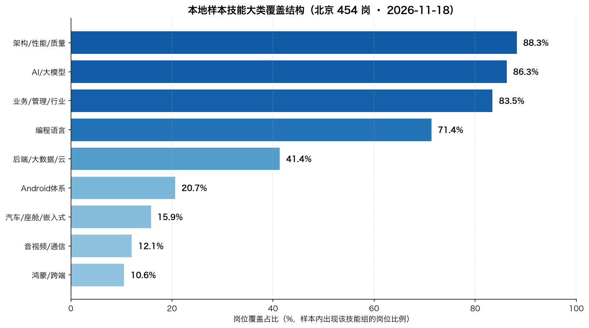
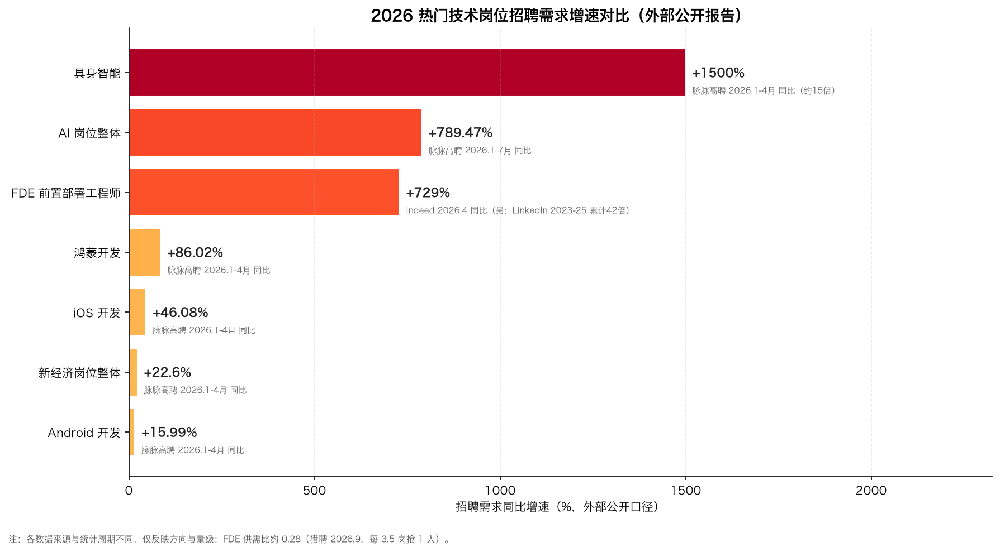

# 岗位技能与需求分析报告

- 采集日期：2026-11-18　|　城市口径：北京　|　样本：去重后 **454** 个岗位
- tab 命中（多对多）：ai_agent 242，fde 171，harmonyos 28，recommend 31，android 72
- 说明：本期为单期快照；与历史快照的环比需跨期汇总，本地链路单期不计算环比。薪资受字体反爬影响未纳入统计。
- 采集状态：三 tab（recommend/harmonyos/android）与两个检索组（ai_agent/fde）合并采集，清洗去噪后 **454** 个唯一岗位。
- 检索组口径：ai_agent 为 AI/大模型/Agent 研发岗；fde 分「核心 FDE」（标题含 FDE/前沿·前线部署）与「相邻交付/解决方案/部署岗」两层，纯销售、投资出版、芯片/FPGA 原型验证、纯客户成功商务岗已剔除。
- 口径：关键词区分「岗位覆盖数」（命中岗位数）与「词频」（出现次数）；纯英文短词按词边界匹配。

## 一、技能分组岗位覆盖

| 技能分组 | 命中岗位数 | 覆盖率 | 代表关键词（覆盖:词频） |
|---|---|---|---|
| 编程语言 | 324 | 71.4% | python(231:265)、java(183:256)、c++(66:81)、go(62:78)、kotlin(49:63) |
| Android体系 | 94 | 20.7% | android(79:335)、sdk(42:108)、framework(20:33)、jetpack(17:22)、binder(7:8) |
| 音视频/通信 | 55 | 12.1% | 视频(35:112)、tcp(11:14)、音视频(9:20)、音频(8:23)、websocket(6:10) |
| 鸿蒙/跨端 | 48 | 10.6% | 鸿蒙(28:66)、flutter(19:36)、跨端(17:27)、跨平台(13:18)、harmonyos(10:20) |
| AI/大模型 | 392 | 86.3% | ai(327:2175)、agent(263:1445)、大模型(259:826)、prompt(127:205)、llm(124:243) |
| 架构/性能/质量 | 401 | 88.3% | 优化(335:890)、架构(222:599)、性能(211:460)、稳定性(131:180)、性能优化(105:143) |
| 后端/大数据/云 | 188 | 41.4% | 数据库(90:143)、分布式(78:119)、全栈(63:106)、微服务(32:37)、大数据(25:39) |
| 汽车/座舱/嵌入式 | 72 | 15.9% | linux(50:59)、车载(11:43)、座舱(11:23)、嵌入式(11:18)、智能座舱(9:14) |
| 业务/管理/行业 | 379 | 83.5% | 团队(310:769)、协作(213:368)、解决方案(88:193)、成本(88:136)、金融(36:113) |

### 本地样本技能大类覆盖结构

### 外部岗位招聘需求增速（公开报告口径）

> 外部公开报告口径，来源与统计周期不同，仅反映方向与量级；本地为单期快照，无法计算环比/同比。

| 方向 | 同比增速 | 来源与周期 |
|---|---|---|
| 具身智能 | +1500% | 脉脉高聘 2026.1-4月 同比（约15倍） |
| AI 岗位整体 | +789.47% | 脉脉高聘 2026.1-7月 同比 |
| FDE 前置部署工程师 | +729% | Indeed 2026.4 同比（另：LinkedIn 2023-25 累计42倍） |
| 鸿蒙开发 | +86.02% | 脉脉高聘 2026.1-4月 同比 |
| iOS 开发 | +46.08% | 脉脉高聘 2026.1-4月 同比 |
| 新经济岗位整体 | +22.6% | 脉脉高聘 2026.1-4月 同比 |
| Android 开发 | +15.99% | 脉脉高聘 2026.1-4月 同比 |

> FDE 供需比约 0.28（猎聘 2026.9，每 3.5 岗抢 1 人）；国内 FDE 平均年薪约 40.8 万元。

## 二、全量高频关键词 TOP 20

| 排名 | 关键词 | 覆盖岗位数 | 词频 | 覆盖率 |
|---|---|---|---|---|
| 1 | 优化 | 335 | 890 | 73.8% |
| 2 | ai | 327 | 2175 | 72.0% |
| 3 | 团队 | 310 | 769 | 68.3% |
| 4 | agent | 263 | 1445 | 57.9% |
| 5 | 大模型 | 259 | 826 | 57.0% |
| 6 | python | 231 | 265 | 50.9% |
| 7 | 架构 | 222 | 599 | 48.9% |
| 8 | 协作 | 213 | 368 | 46.9% |
| 9 | 性能 | 211 | 460 | 46.5% |
| 10 | java | 183 | 256 | 40.3% |
| 11 | 稳定性 | 131 | 180 | 28.9% |
| 12 | prompt | 127 | 205 | 28.0% |
| 13 | llm | 124 | 243 | 27.3% |
| 14 | 智能体 | 114 | 342 | 25.1% |
| 15 | 性能优化 | 105 | 143 | 23.1% |
| 16 | 数据库 | 90 | 143 | 19.8% |
| 17 | 解决方案 | 88 | 193 | 19.4% |
| 18 | 成本 | 88 | 136 | 19.4% |
| 19 | 监控 | 81 | 106 | 17.8% |
| 20 | android | 79 | 335 | 17.4% |

## 三、分 tab 高频关键词

### ai_agent（n=242）

| 关键词 | 覆盖岗位数 | 词频 |
|---|---|---|
| 优化 | 192 | 547 |
| ai | 190 | 1142 |
| 大模型 | 179 | 619 |
| agent | 173 | 1101 |
| 团队 | 165 | 388 |
| python | 142 | 167 |
| 协作 | 129 | 223 |
| 架构 | 119 | 369 |
| 性能 | 109 | 233 |
| java | 99 | 148 |
| llm | 93 | 178 |
| 稳定性 | 82 | 118 |
| prompt | 78 | 124 |
| 智能体 | 77 | 262 |
| 分布式 | 68 | 105 |

### fde（n=171）

| 关键词 | 覆盖岗位数 | 词频 |
|---|---|---|
| ai | 147 | 1184 |
| 团队 | 124 | 346 |
| agent | 110 | 481 |
| 优化 | 109 | 295 |
| python | 106 | 118 |
| 大模型 | 97 | 291 |
| 架构 | 75 | 198 |
| 协作 | 72 | 134 |
| 解决方案 | 66 | 167 |
| 性能 | 65 | 149 |
| prompt | 63 | 109 |
| 智能体 | 50 | 129 |
| java | 46 | 63 |
| llm | 44 | 90 |
| 成本 | 40 | 63 |

### harmonyos（n=28）

| 关键词 | 覆盖岗位数 | 词频 |
|---|---|---|
| 鸿蒙 | 28 | 66 |
| android | 26 | 87 |
| 优化 | 24 | 53 |
| 性能 | 22 | 44 |
| 架构 | 19 | 49 |
| 团队 | 17 | 36 |
| kotlin | 16 | 18 |
| arkts | 16 | 18 |
| java | 15 | 19 |
| 性能优化 | 15 | 18 |
| 协作 | 13 | 16 |
| 稳定性 | 10 | 13 |
| ai | 9 | 41 |
| sdk | 9 | 14 |
| 跨端 | 7 | 15 |

### recommend（n=31）

| 关键词 | 覆盖岗位数 | 词频 |
|---|---|---|
| android | 28 | 129 |
| 优化 | 27 | 58 |
| 性能 | 26 | 54 |
| 架构 | 23 | 50 |
| java | 22 | 24 |
| 团队 | 21 | 36 |
| kotlin | 18 | 23 |
| 性能优化 | 17 | 24 |
| 协作 | 16 | 19 |
| 稳定性 | 15 | 19 |
| ai | 11 | 55 |
| sdk | 11 | 34 |
| 卡顿 | 9 | 11 |
| anr | 8 | 11 |
| jetpack | 7 | 10 |

### android（n=72）

| 关键词 | 覆盖岗位数 | 词频 |
|---|---|---|
| android | 70 | 316 |
| 优化 | 60 | 133 |
| 性能 | 55 | 109 |
| 架构 | 49 | 100 |
| java | 49 | 63 |
| kotlin | 46 | 59 |
| 团队 | 43 | 84 |
| 性能优化 | 35 | 47 |
| 协作 | 29 | 47 |
| 稳定性 | 27 | 38 |
| sdk | 26 | 85 |
| 鸿蒙 | 25 | 62 |
| ai | 20 | 80 |
| arkts | 18 | 22 |
| jetpack | 17 | 22 |

## 四、本期需求观察

本期样本中覆盖度靠前的方向：优化、ai、团队、agent、大模型、python、架构、协作、性能、java。
- Android/鸿蒙客户端主线扎实：Java、Kotlin、ArkTS、Jetpack、Framework、性能与稳定性仍是硬门槛；跨端（Flutter、React Native、跨平台）与 AI/大模型（Agent、大模型、LLM、Prompt）渗透明显。
- 推荐页偏综合与协作：团队协作、解决方案、团队管理、成本与跨部门沟通出现频次高，反映该 tab 混入资深/管理与复合岗。

> 注：趋势方向基于本期样本；跨期环比需结合历史快照汇总。
